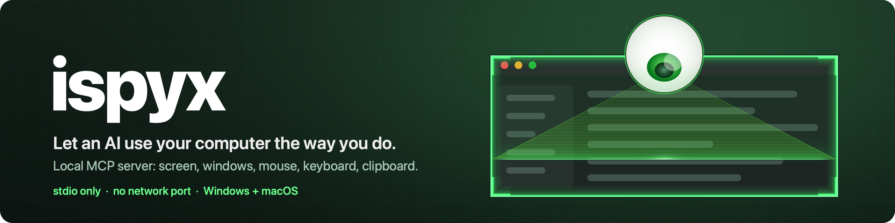
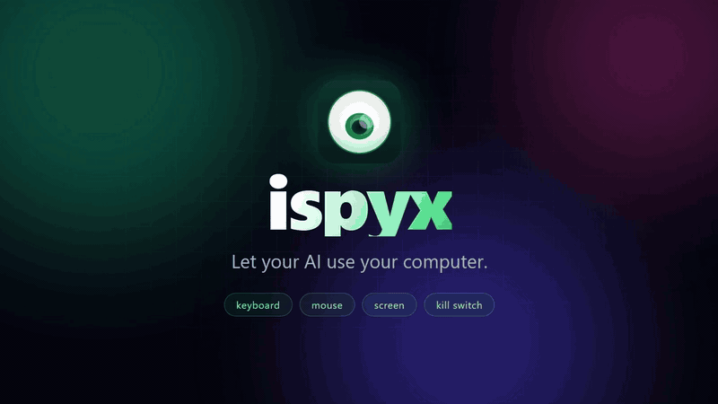

<p align="center"></p>

# ispyx

<p align="center"><a href="docs/showcase/ispyx-demo.mp4"></a></p>

A local desktop-control [MCP](https://modelcontextprotocol.io) server. It lets an AI assistant use your computer the way a person does: look at the screen, move the mouse, click, drag, scroll, type, press hotkeys and use the clipboard.

- Runs on your machine, talks to the AI app over **stdio**, opens **no network port** (the settings panel only listens while it is open).
- Windows and macOS. Windows needs Node.js 22+; the macOS app carries its own.
- One resident app (tray icon on Windows, menu-bar icon on macOS) does the work. Every AI app connects through a thin `ispyx mcp` process, so there is one stop key, one banner and one set of settings.

## Install

### Windows

Open PowerShell and paste:

```
irm https://raw.githubusercontent.com/murat-mehmet/ispyx/master/scripts/install.ps1 | iex
```

No administrator rights needed. It finds or installs Node.js 22+ for your user, runs `npm install -g ispyx`, adds an `Ispyx` shortcut to your Desktop, turns on start at login and starts ispyx. Manual: install Node.js from [nodejs.org](https://nodejs.org), then `npm i -g ispyx` and run `ispyx`.

Uninstall: run the installer with `-Uninstall` (add `-Purge` to also delete settings and logs). Options and troubleshooting: [docs/windows-install.md](docs/windows-install.md).

### macOS

Open Terminal and paste:

```
curl -fsSL https://github.com/murat-mehmet/ispyx/releases/latest/download/install.sh | sh
```

It downloads the newest `Ispyx.app`, checks it (SHA-256, the developer's signature, notarised) and puts it in `/Applications`, then opens it; allow the two permissions its window asks for. Or download the `.dmg` from the [Releases](https://github.com/murat-mehmet/ispyx/releases) page and drag Ispyx to Applications. The app carries its own Node, nothing else is needed. Uninstall: `... | sh -s -- --uninstall` (add `--purge` for settings and logs). Details: [native/macos/README.md](native/macos/README.md).

### Updating

The panel shows when a newer version is out, with an **Update** button. Or run `ispyx update` (macOS: `/Applications/Ispyx.app/Contents/Resources/ispyx update`, or the install command above again). Windows reinstalls the npm package; macOS replaces the app, which keeps its permissions. Settings and logs stay.

## Connect your AI app

Open the panel (tray or menu-bar icon, **Open**): it shows the exact command for your machine with a copy button. Or by hand:

```
claude mcp add ispyx --scope user -- ispyx mcp
```

Other apps (Claude Desktop, LM Studio, ...), JSON form. On Windows some apps need `"command": "cmd", "args": ["/c", "ispyx", "mcp"]`:

```json
{
  "mcpServers": {
    "ispyx": { "command": "ispyx", "args": ["mcp"] }
  }
}
```

On macOS use `/Applications/Ispyx.app/Contents/Resources/ispyx` as the command, without `mcp`. The AI app starts ispyx when needed, so start at login is optional.

## Using it

- **Panel.** Permissions (macOS), recent activity, effects, password, denylist, start at login, the connect command. Opens in its own small window and closes when you close it.
- **Commands.** `ispyx` starts the resident app and opens the panel, `ispyx mcp` is the stdio server for an AI app, `ispyx quit` stops it, `ispyx update` installs the latest version and restarts it. On macOS they are `/Applications/Ispyx.app/Contents/Resources/ispyx update` / `quit` (the app starts the resident itself). Errors go to `%APPDATA%\ispyx\ispyx.log` (macOS: `~/Library/Application Support/Ispyx/ispyx.log`). Details: [src/core/RESIDENT.md](src/core/RESIDENT.md).
- **Stop.** **Alt+Esc** (Option+Esc on macOS): one press cancels everything running, a second press within 5 s shuts the server down.
- **Feedback.** A banner shows while a tool runs (green working, amber cancelled, red stopped). An eye and a scan line show on screenshots, clicks, scrolls and typing get small animations. All of it is click-through and can be turned off in the panel.

## Tools

| Tool | What it does |
| --- | --- |
| `list_windows`, `list_monitors`, `cursor_position` | What is on the desktop and where the pointer is. |
| `focus_window` | Bring a window to the front. |
| `screenshot_screen`, `screenshot_window` | PNG of a monitor, all monitors, a region or one window. |
| `click`, `move`, `drag`, `scroll` | Pointer actions. Clicks take double/triple and held modifiers. |
| `mouse_down`, `mouse_up` | Press and release a button (the pointer moves straight while one is held). |
| `type_text`, `press_keys`, `key_down`, `key_up` | Typing, hotkeys such as `ctrl+v`, hold and release. |
| `get_clipboard`, `set_clipboard` | Read text; write text, an image or a file. |
| `wait` | Pause up to 60 s. |

Typical flow: `screenshot_screen`, read coordinates off the image, `click` (with `space: "shot"`) or `type_text`, then `screenshot_screen` to check. Coordinates and per-tool behaviour: [docs/behavior.md](docs/behavior.md). Input is human-paced: the pointer glides along a curved path, scrolling is smoothed, typing has natural pauses.

## Safety

- **Alt+Esc** is caught by a low-level keyboard hook, so it does not also cycle windows.
- **Denylist** of programs that are never focused or driven (password managers by default); editable in the panel.
- **No credentials.** Typing into password fields is refused; ispyx never reads or types saved passwords.
- **Password gate** (optional, set it in the panel): asks before the first tool call.
- **Action log.** Every action, refusal and error is logged locally, including typed text (not text aimed at a password field). Clipboard reads log the length only.
- **Elevated windows** cannot be controlled on Windows (UIPI), and neither can UAC prompts or the lock screen.
- This gives an AI control of your computer. Connect it only to apps you trust.

## Configuration

Most settings are in the panel. Files and variables, later wins: built-in defaults, `config.json` (package folder or the file in `ISPYX_CONFIG`), the per-user `%APPDATA%\ispyx\config.json` (macOS: `~/Library/Application Support/Ispyx/`), environment variables. See `config.example.json`.

| Key | Variable | Default |
| --- | --- | --- |
| `denylist` | `ISPYX_DENYLIST` (comma separated) | common password managers |
| `auth` | `ISPYX_AUTH` (`0`/`1`) | `false` |
| `overlay`, `animations` | `ISPYX_OVERLAY`, `ISPYX_ANIMATIONS` (`0`/`1`) | `true` |
| `typeSpeed` | `ISPYX_TYPE_SPEED` | `1` (2 = twice as fast) |
| `stopChord` | `ISPYX_STOP_CHORD` | `alt+esc` |
| `logPath` | `ISPYX_LOG` | `logs/actions.jsonl` |
| `authFile` | `ISPYX_AUTH_FILE` | `%APPDATA%\ispyx\auth.json` |

More keys (`maxTypeLength`, `moveMinMs`/`moveMaxMs`, `typeMinMs`/`typeMaxMs`/`typeCapMs`) are in `config.example.json`. The older `WIN_INPUT_*` names still work as fallbacks.

## Development

```
git clone https://github.com/murat-mehmet/ispyx
cd ispyx
npm install
npm test        # unit checks; other scripts in docs/testing.md
```

- `src/core/` shared: MCP server and tools, safety guard, input motion, resident app, panel, password gate.
- `src/platform/` the OS layer (contract in `src/platform/CONTRACT.md`): `win32/` (Win32 through `koffi`), `darwin/` (a client of `Ispyx.app`).
- `src/effects/` animations. `native/macos/` the macOS app (Swift). `scripts/install.ps1` the Windows installer.
- Releases (npm package and macOS DMG) are made by pushing a version tag: [docs/releasing.md](docs/releasing.md).

Tests drive the real desktop and use their own settings (own stop chord, own pipe), so they never touch a server you are using.

## License

See [LICENSE](LICENSE).
